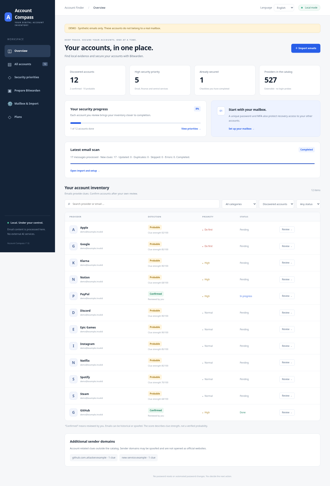

# ARGUS 2.7.0

[Deutsch](README_DE.md) · English

[](https://github.com/Valentindghjg/ARGUS/actions/workflows/ci.yml)

ARGUS is a local Python account inventory with a **German/English dashboard**, **527
extensible providers**, local email analysis and a Bitwarden security checklist.
Users choose their interface language. Email detection always supports both
English and German, independently of that choice.

**What ARGUS promises:** it helps you understand account clues in your own
emails and work through important security tasks under your control. It cannot
find every account, and emails alone cannot prove how well an account is
protected. A completed checklist records your own steps; it is not a security
guarantee.

## Preview

The screenshots below use only the bundled synthetic demo data.

| Dashboard | Security worklist |
| --- | --- |
| [](docs/preview/dashboard.png) | [](docs/preview/worklist.png) |

The app finds **evidence in your own messages**. It does not probe accounts on
provider websites. Missing evidence leaves a service “Unknown”; it does not prove
that no account exists. Synthetic demo data and personal profiles stay separate.

## License

ARGUS is licensed under the
[Mozilla Public License 2.0](LICENSE) (MPL-2.0). Every feature is free: there
are no editions, license keys, online accounts, payment data or telemetry. See
[LICENSING.md](LICENSING.md) and the [publication checklist](docs/PUBLISHING.md).

**Quick start:** Python 3.11 or newer and a modern browser. ARGUS uses only the
Python standard library; npm and Docker are not required.
Extract the archive or clone the repository, open a terminal in its folder
(`ARGUS` for a Git clone), then run:

```bash
python -m pip install .
python -m argus_security --data-dir .local/demo demo --serve --open
```

Open `http://127.0.0.1:8765/` if your browser does not open automatically. Ctrl+C
stops the server. Use `--port 8766` if the port is occupied. On Windows, replace
`python` with `py -3` if needed; on macOS/Linux, use `python3` where appropriate.

The demo uses 18 synthetic messages for two invented own addresses: 13 discovered
accounts at 12 providers, two simulated manual confirmations and one completed
checklist. A short guide on the overview explains the hard cases: a newsletter,
a guest order and a reset email that prove no account, two accounts at one
service, single sign-on and a look-alike sender domain. **These are not your real
accounts.** Its "Try this path" list leads in five steps from the import to the
Bitwarden handover; the [demo guide](docs/DEMO.md) describes them. The
[FAQ](docs/FAQ.md) answers common questions.

You can also clone the GitHub repository:

```bash
git clone https://github.com/Valentindghjg/ARGUS.git
cd ARGUS
python -m pip install .
python -m argus_security --data-dir .local/demo demo --serve --open
```

Use `git pull --ff-only` to update an existing clean checkout. Personal profiles
and credentials are excluded from Git; keep their protected backups separately.

## What this project does

- Finds local evidence for services by matching sender domains in your own email.
- Helps you review accounts, track security work and prepare password-free
  Bitwarden metadata imports.
- Runs locally; it does not mass-probe provider accounts, automate password
  resets, bypass CAPTCHAs or modify email.

It cannot prove that an account does not exist. A missing email, a phone-only
registration, an SSO account, deleted messages or another mailbox can all leave
no local evidence. Read [the safety model](docs/SECURITY.md) before importing
personal email.

## Coverage, keyboard use and a masked view

The overview names what your imports cover: each source with its runs, messages
and last date (every run counts, also those the job list no longer shows), the
period your clues span, months without any clue and own addresses without a
clue. ARGUS cannot know how much of your mail or online
life that is, so it shows no total percentage.

Every control can be reached with the keyboard; a **Skip to main content** link
comes first, the current page is announced, and dialogs keep focus inside.
**Hide personal details** in the top bar masks email addresses on screen (for
example `d•••@e•••.invalid`), which helps when you share your screen. Masking
only changes the display: it is neither encryption nor a cleaned export, and
the choice is remembered only in this browser.

Every check run audits all views and dialogs in German and English, on desktop
and phone width, with [axe-core](https://github.com/dequelabs/axe-core) against
WCAG 2.2 level AA; any violation fails the run. An automated audit finds only
part of what WCAG asks for; a review with screen readers is still to come.

## Choose your language

Use **Language → English / Deutsch** in the dashboard header. The same selector
is available inside an account checklist. The initial language follows your
browser language: German for `de`, English otherwise. Your explicit choice is
remembered in this browser on this local dashboard address. If browser preference
storage is blocked, switching still works for the current page.

Switching preserves filters, checklists, confirmation, assigned sign-in addresses,
Bitwarden selections and import progress. It changes navigation, setup guidance,
categories, detection explanations, dates and checklist labels. Provider names,
URLs, addresses and machine identifiers retain their original values. Custom
catalog names/categories remain as supplied. Email detection always uses both
languages. Different browser profiles can choose different languages.

The CLI follows your system language, or accepts a global flag **before** the
subcommand:

```bash
python -m argus_security --language en --help
python -m argus_security --language de --help
python -m argus_security --language de --data-dir .local/demo demo --serve
```

Human-readable help, prompts, validation and metadata notes use that language.
Command names, flags and JSON keys stay stable for scripts. The browser chooses
its language separately from the terminal. Language switching makes no external
requests; only the two-letter preference is stored in browser Local Storage.
Tokens, email content, account results and credentials are never stored there.

## Your personal profile

Run the app on **your own computer** before processing real emails or credentials.
Replace `your.email@example.org` with your own registration address:

```bash
python -m argus_security init --email your.email@example.org
python -m argus_security serve --open
```

The default personal directory is `~/.local/share/argus/`. A profile from
before the ARGUS rename (`~/.local/share/account-finder/`) is moved there
automatically once, with its files and permissions. To use a
different directory, put `--data-dir /absolute/path` **before the subcommand**;
such a directory is never moved. After `pip install .` the shorter `argus`
command works the same as `python -m argus_security`. The old `account-finder`
command and `python -m account_finder` still work for now but print a
deprecation notice.
Your new personal profile initially has no discovered accounts until emails are
imported. The demo directory is separate.

You can configure multiple own registration addresses:

```bash
python -m argus_security --data-dir .local/personal init --email your.email@example.org --email your.alias@example.org
```

Add another own address later in “Mailbox & Import”, or with:

```bash
python -m argus_security add-email --email your.alias@example.org
```

Adding addresses preserves existing addresses, confirmations and checklists.
Re-import local email files afterwards. The next explicitly authorized IMAP scan
rechecks older messages for the expanded scope. Adding an existing alias does not
reset progress. Up to 64 own addresses can be added to a profile. Plus aliases
are not automatically treated as identical. Personal aliases cannot be added to
the demo profile.

**Your Bitwarden account can use a different email address.** It is not needed by
this app. Each vault item uses the sign-in address of its service, not your
Bitwarden account address. Never put IMAP secrets or your Bitwarden master
password in this chat, the source code or a configuration file.

## Import local emails

Choose multiple **EML files** in “Mailbox & Import”. Data travels only between
your browser and 127.0.0.1. Email bodies are analyzed locally but not stored as
results. Original files stay unchanged. The upload limit is 2 MiB per message;
export large messages without attachments in your email client where practical.

Command-line imports do not use outgoing network connections:

```bash
python -m argus_security import /path/to/eml-folder --format eml
python -m argus_security import /path/to/mailbox.mbox --format mbox
python -m argus_security import /path/to/Maildir --format maildir
python -m argus_security report
```

Maildir needs `cur/` and `new/`. Re-importing does not duplicate evidence or reset
your checklist. Current rules or a newly added provider domain can replace an
older automatic assessment of the same message. A message that no longer provides
evidence loses only its automatic clue; manual confirmations remain.

The dashboard retains statistics for the entire multi-file import after reload.
“Cancel import” stops after the current file and preserves processed clues. You
can also cancel an unfinished import after reloading. Imports idle for ten
minutes are marked interrupted when next accessed. Skipped files, errors and
header-only analysis are visible as “Completed with gaps”. CLI changes appear in
the open dashboard within 15 seconds.

### Only what changed, within a budget, and continue later

ARGUS recognizes a message it already analyzed under the same conditions by its
content fingerprint, never by file name or date, and does not analyze it again;
the result counts it as unchanged. New own addresses, catalog additions or new
rules analyze everything again. A run can be limited to new work with
`--max-messages` or `--max-megabytes`; it then ends as “Limit reached; not
everything was processed”, never as complete. Run the same import again to
continue, also after an interruption or a pause. `--recheck` analyzes every
message again. The index holds fingerprints only, never message content.

ARGUS remembers the last terminal import (source and format) for
`import --again`; the dashboard shows it under “Mailbox & Import” with the
command. Items that were empty, too large or unreadable are listed locally, and
`import --retry-failed` reads only those after you fixed them. A missing source
is reported, never silently replaced. For a large archive, `import --check`
first counts messages, size, new and unchanged messages and oversized items
without importing anything. Files you pick in the browser are never remembered.

```bash
python -m argus_security import /path/to/mailbox.mbox --format mbox --check
python -m argus_security import /path/to/mailbox.mbox --format mbox --max-messages 5000
python -m argus_security import --again          # continues the same source
python -m argus_security import --retry-failed   # only the items that failed
```

### Watch one export folder

If your email program saves EML files into one folder, ARGUS can import new
ones from there while the dashboard runs. You approve exactly one existing local
folder in a terminal; ARGUS reads only `*.eml` files directly in it, never
subfolders, and never changes, moves or deletes a file. It refuses the whole
disk, your home folder, hidden folders, links, network paths and the profile
folder. The watch appears under “Control” as a permission and a waiting job,
follows the global pause and can be stopped there; a missing folder is
reported, never searched for elsewhere.

```bash
python -m argus_security watch-folder enable ~/Mail/ARGUS-export --interval-minutes 5
python -m argus_security watch-folder status
python -m argus_security watch-folder disable
```

## Identify your email provider

For a custom domain, the provider cannot be inferred from the address alone.
Replace `example.org` with your own mail domain in these commands.
**No real MX lookup or mailbox connection has been performed for you.** Offline
guidance:

```bash
python -m argus_security discover --domain example.org
```

If you explicitly authorize the public DNS query:

```bash
python -m argus_security discover --domain example.org --allow-dns
```

Only the domain is sent to your DNS resolver, not the full email address or any
credentials. Results contain MX records and possible provider hints. MX describes
the receiving route; an upstream spam filter can hide the real mail host. Verify
the actual IMAP settings in your email client, hosting account or official
provider documentation. No guessed IMAP host is tried automatically.

On Windows, `/etc/resolv.conf` may not provide a system resolver. Use an explicitly
selected resolver IP with `--resolver RESOLVER-IP`, configure offline, or run
`Resolve-DnsName -Name example.org -Type MX` yourself. That PowerShell command
also makes a network query; the app does not run it automatically.

## Set up secure IMAP

1. Create a separate **IMAP app password** with your actual provider if supported.
2. Verify the documented host. Do not guess or try a list of hosts.
3. Save settings without credentials:

```bash
python -m argus_security setup-imap
```

The assistant asks for the host and username and saves private `imap.json`; it
does not connect. Defaults: TLS port 993 and all selectable folders, including
archives. To choose folders explicitly:

```bash
python -m argus_security setup-imap --host VERIFIED-IMAP-HOST --username your.email@example.org --folder INBOX --folder Archive
```

Replace `VERIFIED-IMAP-HOST` with the actual host. Folder names depend on the
provider. Existing `imap.json` is not overwritten; edit it locally to change
settings. Do not add credentials. Only these fields are accepted:

```json
{
  "host": "imap.mailprovider.example",
  "username": "your.email@example.org",
  "port": 993,
  "auth": "app_password",
  "folders": ["*"]
}
```

4. Explicitly authorize the connection, first with a limited scan:

```bash
python -m argus_security scan-imap --allow-imap --list-folders
python -m argus_security scan-imap --allow-imap --limit 500
python -m argus_security scan-imap --allow-imap
```

The secret is entered in a hidden interactive terminal prompt on every run and
is not saved. TLS certificates and hostnames are checked. Folders are opened
read-only; messages use `BODY.PEEK`; sessions end with LOGOUT. No read flags,
deletions or email modifications. Messages over 2 MiB use at most 64 KiB of headers,
with a reduced clue score and visible coverage warning.

UID checkpoints support resuming. “Limit reached” means messages remain; rerun the
authorized scan to continue. Reaching the limit exactly at the end of selected
folders completes normally. Errors, skips and header-only analysis indicate gaps.
Changing the address scope during a scan interrupts it; restart to use the new
scope. Use `--full-scan` to explicitly recheck previously read messages; it starts at
the first message every time, so it runs without `--limit`.

### Optional scheduled scans

After you have verified `imap.json` with a manual read-only scan, you can opt in
to incremental scans while the local ARGUS dashboard is running. Install a
supported **OS-protected** Python keyring first; ARGUS refuses plaintext keyring
backends and has no file fallback:

```bash
python -m pip install keyring
python -m argus_security background-imap enable --interval-minutes 1440 --limit 500
python -m argus_security serve --open
```

The command asks for the separate app password or externally obtained OAuth2
token only in a hidden terminal prompt. It saves that secret only in the OS
keyring; the local SQLite database keeps an opaque selector and schedule metadata
only. The first scan is due when the dashboard starts, then it resumes from the
normal IMAP UID checkpoints. It never runs when ARGUS is closed, does not do a
full rescan, does not change mail, and backs off after a safe fixed error.

The approval covers exactly the settings shown by `enable` (host, port,
username, sign-in method and folders). If `imap.json` changes later, scheduled
scans stop before using the stored authorization; run `background-imap enable`
again to approve the new settings. Schedules created before this check also ask
for one new approval.

Check, pause, or remove the authorization with:

```bash
python -m argus_security background-imap status
python -m argus_security background-imap disable
python -m argus_security background-imap revoke
```

`disable` pauses future scans while retaining the keyring entry. `revoke`
disables scans first and then removes the entry from the OS keyring. A scan that
is already running notices this within about 15 seconds and stops before its
next message fetch. Dashboard
setup shows status only and never accepts a password or token.

### OAuth2 and provider differences

Exchange Online requires OAuth2 where Basic Authentication is disabled; an app
password does not bypass this. Choose `--auth oauth2` during setup or edit the
field in `imap.json`. XOAUTH2 accepts a **short-lived access token obtained
externally**, entered in a hidden terminal prompt. The app does not register an
OAuth application, run a login flow, or save refresh tokens. Obtain authorization
through your provider or administrator; use a local email export if that is not
practical.

Google app passwords depend on account and security settings; managed accounts
may impose further restrictions. Follow the official provider documentation.
Proton Mail does not provide an ordinary direct IMAP login. The local Bridge is
not automatically configured by this TLS-only scanner; use official export tools
and import EML/mbox instead.

## Optional browser companion

`browser-companion/` contains an unpacked Chromium extension prototype. When you
open its popup, it checks only the active tab’s hostname against a bundled public
ARGUS catalog. It can copy or open a verified password-management link where one
exists. It never reads page content, forms, cookies, passwords, history, tokens,
email or Bitwarden data, and a site visit never creates or confirms an account.

```bash
python browser-companion/scripts/build.py
python browser-companion/tests/validate.py
```

Load the generated `browser-companion/dist/` with your Chromium browser’s
**Load unpacked** option. See its [companion guide](browser-companion/README.md).

## Resume a security worklist

Open **Security worklist** and choose **Secure next account** to let ARGUS add
one highest-priority incomplete local account to the worklist. Your queue, pause
state and checklists persist locally after a restart. Each dialog shows the next
missing step. The guided Bitwarden button has a second confirmation and creates
one password-free item only for the current account. Accounts using SSO or
passkeys skip a separate password change. Nothing is submitted to a provider
automatically.
Choose **Build priority worklist** to explicitly add up to ten more highest-
priority incomplete accounts in deterministic local order. Existing worklist
items keep their place; the action changes no checklist, password, provider or
Bitwarden item. Before the button can be used, the worklist shows the exact local
priority preview, including each account's current next step. Review it before
confirming the append action.
For an account that cannot be handled immediately, choose **Tomorrow** or **In
one week**. ARGUS stores the date only in the local worklist and makes the item
ready again when that date is reached while the dashboard is open. It sends no
notification and contacts no service.
For a different date, choose it in the worklist calendar and select **Schedule
date**. Dates must be in the next 365 days and are saved only locally.
For review, password-change, sign-in and MFA/recovery steps, **I completed this
step** records your explicit local confirmation and immediately advances the
guide.
See the [worklist guide](docs/WORKLIST.md) and
[interrupted-transfer guidance](docs/BITWARDEN_CLI.md).

## Priorities and identity accounts

Each account shows why it has its priority: the catalog's rating for that kind
of service, and accounts that others depend on. You can note which confirmed
account hosts the mailbox of each own address (“Where your mailboxes are” under
“Mailbox & Import”) and, for an account that uses single sign-on, which
confirmed account it signs in with. Such identity accounts become “Do first”
with the reason shown, and worklist suggestions list them first, each with a
short “Why”. ARGUS never infers these relations from emails or website visits.
Your own priority choice always wins; choose **Automatic** to return to the
derived one. **Move up** and **Move down** change the worklist order and can
be undone; adding suggestions never reorders tasks you planned. Priorities only
order your work; they are not a measured risk of attack.

```bash
python -m argus_security mailbox you@example.org google
python -m argus_security sign-in-with notion google
python -m argus_security sign-in-with notion --remove
```

## Control: jobs, activity and one pause for everything

“Control” lists every import, IMAP scan and Bitwarden check or transfer with
its state (running, paused, completed, completed with gaps, failed, cancelled,
needs approval, result unclear, interrupted) and shows a scheduled scan as
waiting until its next time, so no background work stays hidden. **Pause all
automation** blocks new jobs and stops running ones between two messages, within
about a second; saved
clues and IMAP checkpoints stay, and nothing already done outside ARGUS is
undone. The overview keeps the pause visible until you resume. The activity log
keeps time, job type, result and counts only (no email text, addresses, secrets
or command output), at most 500 entries for 180 days.

Under “Permissions”, Control shows the one standing approval ARGUS can hold:
scheduled IMAP scans, with host, folders, limit, interval, approval date and
how many folders continue from a saved checkpoint (never the username or a
secret). A changed host, account, sign-in method or folder selection shows as
“Needs approval” and is not used. **Revoke approval** ends it for good and
removes the stored authorization from the system keyring; a pause only holds
jobs. Manual IMAP scans, Bitwarden transfers and MX lookups are approved each
time instead. `background-imap preview` shows what an approval would cover
without connecting, and `enable` shows the same before asking for the password.

```bash
python -m argus_security automation status
python -m argus_security automation pause
python -m argus_security automation resume
python -m argus_security background-imap preview --interval-minutes 60 --limit 200
```

## Short sessions, review dates and the checklist by sign-in method

Under “Security worklist”, **One task** or **Three tasks** starts a short
session with the next ready tasks. There is no time limit. The session shows
what you recorded since it started; **Preview report** shows the complete text
file (account names and steps only, no addresses, evidence or passwords) before
your browser saves it. The checklist follows the sign-in method you chose:
single sign-on and passkey accounts get matching steps instead of a password
change, and an account that depends on an incomplete sign-in account says so.

A **review rule** (after 6, 12 or 24 months; high-priority or all completed
accounts) proposes a date to check completed accounts again. Nothing changes
until you choose **Use this date** or **Use proposed dates**, which can be
undone. Age alone is no sign of a security problem. Bitwarden notes now also
carry the sign-in method and sign-in account you confirmed and a verified
password-settings page; unknown values stay out.

```bash
python -m argus_security session start --size 3
python -m argus_security session report
python -m argus_security session end
python -m argus_security review-rule --months 12 --scope important --apply
```

## What's new since your last review

After an import, “What's new” shows only clues that are new or rated
differently since you last marked changes as reviewed. The same email imported
again does not reappear. Clues are grouped by account; items that need your
decision (a sender outside the catalog, clues without a clear account, a sign-in
address to choose, new evidence after a rejection) come first. Advertising,
orders and reset requests are only counted. Gaps of the last import (skipped,
unreadable or header-only messages) stay visible until you mark them reviewed.

When you come back, the overview sums this up in one place: import gaps and
unclear Bitwarden transfers first, then new items to decide, new clues and
reached review dates. **Mark as reviewed** changes no decision and no step and
can be undone once from the message. Grouping never confirms, merges or assigns
an account. The CLI offers the same:

```bash
python -m argus_security whats-new
python -m argus_security whats-new --mark-reviewed
```

## Unclear items, hidden domains and address notes

“Unclear items” collects everything your emails cannot settle, so you decide
once instead of in many places: accounts that need their sign-in address,
services with clues that name no clear account, rejected accounts with new
evidence and sender domains outside the catalog. ARGUS never picks an address
or merges accounts for you.

A sender domain outside the catalog can be hidden with a reason (newsletter,
spam, not relevant). New clues from it bring it back, and “Show again” undoes
the exclusion. Under “Mailbox & Import” you can note how two of your own
addresses relate (same mailbox, or replaced by); the note appears on the
affected accounts and never merges them. The CLI offers the same:

```bash
python -m argus_security unclear
python -m argus_security exclude newsletter-sender.example --reason newsletter
python -m argus_security relate old@example.org new@example.org --kind replaced_by
```

## Review and secure accounts with Bitwarden

Each sign-in identity has its own entry, checklist, worklist and Bitwarden
handoff. Strong direct evidence at different own addresses produces separate
probable entries; review them because aliases and address changes may still
refer to one account. In account details, **Add another account at this service**
lets you explicitly add a known local record, including labeled accounts that
share an email address. Nothing is created at the provider. See the
[separate-account and migration guide](docs/ACCOUNTS.md).

Each provider has an official website, category, known own sign-in addresses,
clue type and strength, status and security priority. Documented password-settings
links are supplied for Google, Apple and GitHub with source and verification date.
Others link to the curated homepage; email links are never used for this purpose.

Every account shows three separate marks; “What the three marks mean” below the
list explains them:

- **Evidence** (automatic): probable, weak, older or none. It follows your
  imported emails, which may be historical or spoofed. “None” never means
  “does not exist”. A score is a heuristic clue strength, not a probability.
- **Your decision**: open, confirmed by you, or rejected with a reason (not
  mine, not an account, closed). New evidence never changes it; strong new
  evidence after a rejection only shows a hint. Rejected accounts leave the
  lists, the worklist and suggestions.
- **Progress**: your five dated steps. Complete means each step is done or not
  applicable. It is not a security guarantee.

Newsletters, guest orders and reset requests do not establish an account.
Multiple own To-recipients are ambiguous; no arbitrary sign-in address is
selected.

Click “Review”, decide whether the account is yours, then work through the
steps: check how you sign in (assign a known own address if needed), store it in
Bitwarden, set a unique password (not needed with SSO or a passkey), test the
sign-in and review MFA and recovery (or mark them not offered or not used).
Generate new passwords **in Bitwarden** and change them yourself at the
provider. Each done step records its date and can get a local review date. A
password-free item that ARGUS created is shown as “prepared” until you tick the
vault step. The toast after each change and “Your recent changes” in the
worklist undo your local decisions and steps; Bitwarden items and scans are
never undone. You can confirm a catalog provider even without email evidence.

### Three equal ways, readiness and one journal

“Prepare Bitwarden” offers three equal ways, none of which needs ARGUS to read
your vault: **1 · Already in your vault** marks the selected accounts as stored
after you looked yourself (undoable; also `bitwarden-assign --id …`), **2 ·
Download a password-free file**, and **3 · Optional: Bitwarden CLI** for direct
creation. Checking existing items with the CLI reads your vault and needs its own
tick for that one check. Each account shows its readiness first: “Ready”,
“Check first” (not confirmed by you, or no sign-in address so the username stays
empty) or “Not now” (sign-in address to choose, an unclear transfer, a download
whose import is not recorded, or already in Bitwarden). Ready is no security
statement. The transfer journal lists every download and CLI transfer; an
unclear one blocks another attempt until you record what you found in your
vault, so a file is never imported twice by accident. In a terminal,
`bitwarden-journal list` shows those entries and
`bitwarden-journal resolve ID --found` (or `--not-found`) records the result.
On Windows ARGUS runs only the standalone `bw.exe` found on PATH, not npm's
`bw.cmd` wrapper.

Under “Prepare Bitwarden”:

1. Optionally choose **Check selected accounts in unlocked Bitwarden**. After a
   separate confirmation, ARGUS uses the already-unlocked official CLI to search
   only for each selected account and returns only **found / possible / none**
   plus a count. The CLI response may contain vault fields while it is being
   processed, but ARGUS neither saves nor displays names, usernames or passwords.
   Review any possible match yourself.
2. Assign existing vault items first. Those providers are excluded from downloads.
3. Select genuinely missing items. Probable accounts are not selected by default;
   your explicit selection survives automatic refreshes.
4. Download **metadata JSON**. Items contain provider name, official URI, identified
   address and notes. Password fields are empty; TOTP is null.
5. In the official Bitwarden app, choose Import → **Bitwarden (json)** and import
   into your existing vault, regardless of its account email address.
6. Import the file **once**, check the result, then delete it. Bitwarden adds items
   without duplicate checking. This JSON-import path never reads or overwrites
   vault entries. Importing an empty item does not mean a password change
   succeeded.

Alternatively, after you unlock the official Bitwarden CLI in your own terminal,
the dashboard can create the explicitly selected password-free items directly.
The separate optional audit is read-only; the creation action never reads or
overwrites existing items. Neither action receives your master password. Follow
the [Bitwarden CLI handoff guide](docs/BITWARDEN_CLI.md).

Before either path writes anything, the dashboard shows exactly what will be
written: name, official website, sign-in address, note and extra fields for each
item, plus the accounts left out because the local journal records them as
created. Password, TOTP, passkey and recovery fields are never part of an item.

A command-line metadata export is also supported. Add `--preview` to see the
items first; it creates no file:

```bash
python -m argus_security bitwarden-export /local/protected/path/argus-bitwarden.json --id github --id steam --preview
python -m argus_security bitwarden-export /local/protected/path/argus-bitwarden.json --id github --id steam
```

CLI exports are created with private permissions and never overwrite existing
files. JSON contains no passwords but does contain personal metadata. Browser
downloads use the permissions and backup settings of your downloads directory.

## Extend the provider catalog

`argus_security/data/providers.json` contains 527 curated providers. Add a separate
JSON file without editing the built-in catalog:

```bash
python -m argus_security --providers examples/providers-extra.json --data-dir .local/demo-custom demo --serve
```

The example is synthetic and uses `.example`. IDs and domain roots must be unique;
websites must use HTTPS and belong to a configured provider domain. Subdomains
are matched automatically; more specific domains take precedence. Do not assign
generic shared email-delivery domains to a service. Custom names and category
labels are used as supplied.

### Add a provider in the dashboard

In “Unclear items”, **Add to my catalog** fills in a form for a sender domain
outside the catalog. ARGUS checks the entry like the built-in catalog (unique
domains, an HTTPS website on one of the sender domains, an existing category)
and saves it only in your profile as `my-providers.json` with private
permissions. It never looks the provider up online. Shared sending services
(bulk-mail platforms such as `sendgrid.net` or `amazonses.com`) are refused,
because they send mail for many companies. Stored clues keep their old
assignment until you import the original emails again; ARGUS never stored
their content. Under “Mailbox & Import” you can remove an addition as long as
no clue, decision or step refers to it.

After a re-import, the import result lists clues whose rating changed under the
current rules, with the old and new reason and score; the CLI prints the number.
Your decisions and steps stay as they were.

A password link requires `password_url`, `password_source` and
`password_verified`. Add these only after verifying an official source. Re-import
emails or run `scan-imap --allow-imap --full-scan` afterwards, and restart the
dashboard with the same additional catalog.

## Separate profiles, progress over time and reports

`--profile NAME` uses a separate named profile, for example one for work and one
for private accounts. Each profile is its own folder next to the default one,
with its own database, mailbox settings, catalog additions, backups and
approvals; nothing is shared or read across profiles. Run a second dashboard
with its own `--port`. `argus profiles` lists the names only.

The overview shows how your counts moved over the last week, month and quarter.
For this ARGUS keeps one row of counts per day (clues, accounts found, confirmed,
complete, still open, unclear, open with high priority), never names, addresses
or evidence, for about thirteen months. **Preview report** creates a
data-minimal progress report: numbers only, or numbers and one line per account.
Sign-in addresses are added only when you tick them. The text is shown in full
before your browser saves it.

```bash
python -m argus_security --profile work init --email you@work.example
python -m argus_security --profile work serve --port 8766
python -m argus_security profiles
python -m argus_security report --text --level tasks
python -m argus_security report --level numbers --export /local/path/argus-report.txt
```

## Task templates

“Task templates” in the worklist plan recurring work. A template is plain data,
never a script or browser macro: which accounts it covers (catalog categories,
a minimum priority, only confirmed accounts) and what it plans (add them to the
worklist, a review date for chosen steps). ARGUS ships two templates, a yearly
check of important accounts and a recovery check for finance accounts, and you
can save your own. **Preview** names every affected account first; **Apply
template** is one change you can undo. Templates never act at a provider.

```bash
python -m argus_security template list
python -m argus_security template preview yearly-important
python -m argus_security template apply yearly-important
```

## Plan an address change

When you give up an address, “Plan an address change” under “Mailbox & Import”
lists every account that signs in with it: accounts others depend on first (for
example the one hosting the mailbox), then by priority. Change the address at
each provider yourself and mark the account as changed or skipped; ARGUS
changes nothing at providers and never moves an account's sign-in on its own.
The plan also notes that the old address was replaced by the new one.

```bash
python -m argus_security move-address create old@example.org new@example.org
python -m argus_security move-address mark PLAN_ID github --state changed
python -m argus_security move-address list
```

## Back up and restore your profile

ARGUS saves a backup automatically before a new version updates the profile
database, and it refuses to open a profile from a newer version. You can also
make and restore backups yourself:

```bash
python -m argus_security backup                 # into the profile's backups folder
python -m argus_security backup --output /encrypted/drive/argus
python -m argus_security backup --list
python -m argus_security restore /path/argus-backup-….zip         # shows what it would restore
python -m argus_security restore /path/argus-backup-….zip --yes   # replaces the profile
```

A backup is one ZIP file with the database and the password-free `imap.json`.
It is **not encrypted** and contains personal metadata; keep it on an encrypted
drive. Files are created with private permissions and never overwritten.
Restoring checks every checksum and the database first and saves the current
state as another backup. Stop the dashboard and scans before restoring.
Keyring authorizations are not part of a backup, so scheduled scans may need a
new `background-imap enable`. The newest five automatic backups are kept;
your own backups are never deleted.

## Upgrade and tests

The repository includes GitHub Actions checks for Python 3.11–3.14 on Linux,
unit tests and a package installation check on Windows and macOS, and
German/English browser regression tests.
These use synthetic data and do not connect to personal mailboxes or Bitwarden.
See [contributing](CONTRIBUTING.md) for development and
[security reporting](SECURITY.md) for confidential vulnerability reports.

Version 1.9 migrates provider-wide state to separate account identities. Stop the
app and back up your protected profile before upgrading. Progress follows one
unambiguous or explicitly assigned address; unresolved legacy progress stays
visible for review and is never copied to every sibling account. Use version
1.9 or newer with the migrated profile. See [migration details](docs/ACCOUNTS.md).

Version 1.7 adds a persistent security worklist and a durable Bitwarden transfer
journal that blocks retries after ambiguous writes. Existing inventories gain two
new local tables automatically; evidence and checklists are preserved. Back up
your protected data directory before upgrading.

Versions 1.5 and 1.6 added a Free/Pro presentation and offline Pro licenses. The
next major version removes both again because every feature stays free. A
leftover `license.json` in an old profile is ignored and can be deleted.
Detection, the database schema and account results remain compatible. Version 1.4
expands the built-in catalog from 372 to 527 providers. Existing profiles and checklists remain compatible.
Re-import local source emails or run a separately authorized
`scan-imap --allow-imap --full-scan` to evaluate the new domains against them.
This does not modify the original emails. See [the change log](docs/CHANGELOG.md).

Tests use synthetic messages, fake IMAP and local loopback connections only:

```bash
python -m unittest discover -s tests -v
```

The optional browser test needs an already installed Playwright library and
Chromium, neither of which is required to run the app:

```bash
python scripts/browser_smoke.py --browser /usr/bin/chromium --screenshots-dir docs/preview
python scripts/browser_multi_account.py --browser /usr/bin/chromium
```

The accessibility audit also needs Node.js for the pinned axe-core, a test tool
that never ships with ARGUS:

```bash
npm ci --prefix scripts/accessibility --ignore-scripts
python scripts/browser_accessibility.py --browser /usr/bin/chromium
```

### Synthetic detection benchmark

`python scripts/benchmark.py` runs invented messages from
`benchmarks/detection-cases.json` through the same analysis as an import. Each
case states what the message really shows and what ARGUS does with it; where the
two differ, the case documents the limit (for example forged senders, other
languages, unusual wording). The report counts hits, messages kept for review,
misses and false alarms. **The cases are synthetic, so the numbers are not proof
of accuracy on real mailboxes.** A unit test fails when an outcome changes, so a
rule change has to update the case and its explanation. `--json` prints the full
report.

### Bug reports and releases

`argus about` prints what a bug report needs: the ARGUS, Python, SQLite and
schema versions, the platform and counts such as clues or jobs per state. It
never shows addresses, providers, paths or messages, only reads an existing
profile and creates none. The bug report form asks for this output and for
synthetic steps; see the [FAQ](docs/FAQ.md).

`python scripts/release_check.py` checks that the package and both change logs
name the same version, that every module able to reach the network or start a
program is declared, and that the browser companion keeps only `activeTab`.
The "Release files" workflow runs it on a version tag, builds the files and
lists their checksums. Its build job needs only read access; for a tag, a
separate job that runs no project code records a signed build provenance
attestation for the wheel and the source archive, so
`gh attestation verify <file> --repo Valentindghjg/ARGUS` shows that a file
was built by this workflow from the tag. Only after that does a third job
publish the release with exactly these files and the notes from
`docs/releases/<tag>.md`, written from the
[release notes template](docs/RELEASE_NOTES_TEMPLATE.md), which always names new
connections and permissions. Only the owner's tag starts a release. See
[publishing](docs/PUBLISHING.md).

| File | Purpose |
|---|---|
| `argus_security/analysis.py` | Local MIME parsing and bilingual detection rules |
| `argus_security/data/providers.json` | Extensible provider catalog |
| `argus_security/i18n.py`, `data/translations.json` | Local German/English presentation |
| `argus_security/store.py` | SQLite evidence and checklist persistence |
| `argus_security/instances.py` | Stable account identities and conservative profile migration |
| `argus_security/imap_client.py` | TLS IMAP, PEEK and resuming |
| `argus_security/background.py` | Explicit keyring-backed incremental IMAP schedule |
| `argus_security/discovery.py` | Explicitly authorized MX hints |
| `argus_security/bitwarden.py` | Official metadata-only import format |
| `argus_security/server.py`, `web/` | Local dashboard |
| `argus_security/cli.py` | Command line (`argus`), default profile and its one-time move |
| `argus_security/scan.py` | EML, mbox and Maildir import sessions and the synthetic demo |
| `argus_security/registry.py` | Strict provider-catalog validation, domain matching and shared senders |
| `argus_security/catalog.py` | The profile's own catalog additions |
| `argus_security/states.py`, `changes.py` | Separate account states (ADR-0001), change log and undo |
| `argus_security/review.py` | Unclear items, hidden sender domains and address notes |
| `argus_security/summary.py`, `guidance.py` | Result summary, next task and next-step hints |
| `argus_security/digest.py` | What's new since the last review and the return summary |
| `argus_security/identity.py` | Confirmed sign-in and mailbox relations and explained priorities |
| `argus_security/sessions.py`, `reviews.py` | Short work sessions with their report, and the review rule |
| `argus_security/jobs.py` | Shared job states, the global pause and the minimal activity log |
| `argus_security/imports.py` | Processed-message index, import budget and continuation |
| `argus_security/watch.py` | The narrow, opt-in watch of one export folder |
| `argus_security/profiles.py`, `history.py`, `reports.py` | Named profiles, daily counts and data-minimal reports |
| `argus_security/moves.py` | Ordered, manual plans for moving accounts to another own address |
| `argus_security/templates.py` | Declarative task templates with preview |
| `argus_security/coverage.py` | What imports cover: sources, period and gaps |
| `argus_security/about.py` | Versions, platform and counts for a bug report, never content |
| `argus_security/backup.py` | Local profile backups and restore |
| `argus_security/workflow.py` | Local security worklist and guided next step |
| `argus_security/handoffs.py` | Durable Bitwarden transfer journal |
| `argus_security/mailbox_lease.py` | One mailbox session per profile across processes |
| `argus_security/errors.py` | Fixed, translatable messages that may reach the dashboard |
| `account_finder/` | Deprecated alias for `python -m account_finder` and `account-finder` |
| `tests/` | Automated regression tests |
| `scripts/benchmark.py`, `benchmarks/` | Synthetic detection benchmark |
| `scripts/release_check.py` | Release check: versions, declared connections and permissions, checksums |
| `browser-companion/` | Minimal unpacked Chromium domain/settings-link companion |
| [Catalog policy](docs/CATALOG.md) | Scope, review standards and how to propose providers |
| [Publishing checklist](docs/PUBLISHING.md) | Owner-controlled steps before making the repository public |
| [Product strategy (German)](docs/strategy/README.md) | Master plan for features and safe automation, with implementation status |
| [Technical plan](docs/PLAN.md) | Architecture and development sequence |
| [Security model](docs/SECURITY.md) | Privacy, protections and limits |
| [Privacy statement](PRIVACY.md) | What the local app processes and when it connects |
| [Support](SUPPORT.md) | Discussions, issues and safe reporting rules |
| [Test report](docs/TEST_REPORT.md) | Checks actually performed |
| [Official sources](docs/SOURCES.md) | Bitwarden, settings links and mail providers |

**Run personal analysis on your own computer.** A remote development environment
processes data on that remote machine, not locally on your device. Use synthetic
demo data there. Do not publish the dashboard or forward its port without access
protection. The database is not encrypted by the app; use drive encryption and
protected backups.
