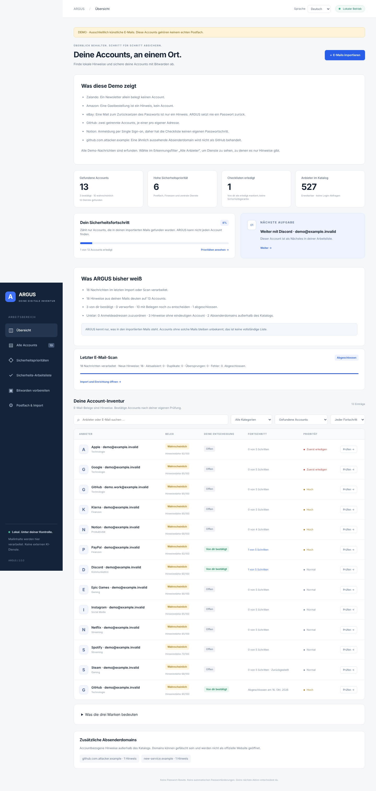
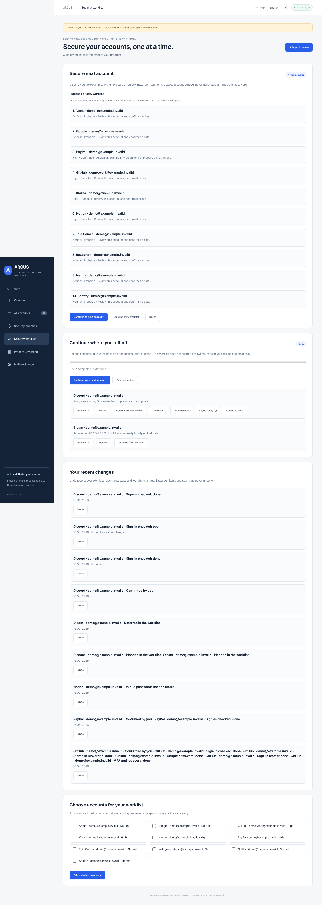

# ARGUS 2.0.0 – lokales Account-Inventar

Deutsch · [English](README.md)

[](https://github.com/Valentindghjg/ARGUS/actions/workflows/ci.yml)

ARGUS ist ein lokales Python-Programm mit **deutscher und englischer Weboberfläche**, **527
erweiterbaren Diensten**, lokaler E-Mail-Analyse und einer Checkliste zum
Absichern mit Bitwarden. Die Nutzer wählen ihre Sprache selbst. Die Erkennung von
Mails funktioniert unabhängig davon immer auf Deutsch und Englisch.

**Was ARGUS verspricht:** Es hilft dir, Account-Hinweise in deinen eigenen
E-Mails zu verstehen und wichtige Sicherheitsaufgaben kontrolliert abzuarbeiten.
Es kann weder alle Accounts finden noch allein aus E-Mails beweisen, wie gut ein
Konto geschützt ist. Eine erledigte Checkliste hält deine eigenen Schritte fest;
sie ist keine Sicherheitsgarantie.

## Vorschau

Die Bilder zeigen ausschließlich die mitgelieferten künstlichen Demodaten.

| Dashboard | Sicherheits-Arbeitsliste |
| --- | --- |
| [](docs/preview/dashboard-de.png) | [](docs/preview/worklist.png) |

Die Anwendung findet **Hinweise in deinen eigenen Nachrichten**. Ein fehlender
Hinweis bedeutet „Unbekannt“ und beweist nicht, dass kein Account existiert.
Künstliche Demo und persönliche Ergebnisse bleiben getrennt.

## Lizenz

ARGUS steht unter der
[Mozilla Public License 2.0](LICENSE) (MPL-2.0). Alle Funktionen sind kostenlos:
Es gibt keine Editionen, Lizenzschlüssel, Online-Konten, Zahlungsdaten oder
Telemetrie. Details stehen in [LICENSING.md](LICENSING.md) und in der
[Veröffentlichungs-Checkliste](docs/PUBLISHING.md).

## In zwei Minuten starten

Voraussetzung: **Python 3.11 oder neuer** und ein aktueller Browser. ARGUS nutzt
nur die Python-Standardbibliothek; npm und Docker sind nicht nötig.

1. Projektarchiv entpacken oder Repository klonen und ein Terminal in diesem Ordner
   öffnen (bei einem Git-Klon `ARGUS`).
2. Python-Version mit `python --version` prüfen. Auf Windows bei Bedarf alle
   `python`-Befehle durch `py -3` ersetzen; auf macOS/Linux gegebenenfalls `python3`.
3. Demo starten:

```bash
python -m pip install .
python -m argus_security --data-dir .local/demo demo --serve --open
```

Der Browser öffnet `http://127.0.0.1:8765/`. Falls er nicht automatisch öffnet,
diese Adresse selbst aufrufen. Strg+C beendet den Server. Die Demo enthält 18
künstliche Nachrichten an zwei erfundene eigene Adressen: 13 gefundene Accounts
bei 12 Anbietern, zwei simulierte manuelle Bestätigungen und eine erledigte
Checkliste. Eine kurze Erklärung in der Übersicht zeigt die schwierigen Fälle:
Newsletter, Gastbestellung und Rücksetz-Mail belegen keinen Account, zwei
Accounts beim selben Dienst, Single Sign-on und eine ähnlich aussehende
Absenderdomain. **Das sind keine echten Accounts.**
Mit `--port 8766` lässt sich ein bereits belegter Port umgehen.

Alternativ das GitHub-Repository klonen:

```bash
git clone https://github.com/Valentindghjg/ARGUS.git
cd ARGUS
python -m pip install .
python -m argus_security --data-dir .local/demo demo --serve --open
```

Eine bestehende Arbeitskopie ohne lokale Änderungen aktualisierst du mit
`git pull --ff-only`. Persönliche Profile und Zugangsdaten sind von Git
ausgeschlossen; sichere sie separat geschützt.

## Was dieses Projekt macht

- Es findet lokale Hinweise auf Dienste über Absenderdomains in deinen eigenen
  E-Mails.
- Es hilft beim Prüfen von Accounts, beim Nachverfolgen der Absicherung und bei
  passwortfreien Bitwarden-Metadatenimporten.
- Es läuft lokal. Es probiert keine Account-Logins massenhaft aus, löst keine
  Passwort-Resets aus, umgeht keine CAPTCHAs und verändert keine E-Mails.

Fehlende Hinweise beweisen nicht, dass kein Account existiert. Registrierung per
Telefon, SSO, andere Postfächer oder gelöschte Nachrichten können ohne lokalen
Hinweis bleiben. Vor persönlichen Daten bitte das
[Sicherheitsmodell](docs/SICHERHEIT.md) lesen.

## Sprache wählen

Im Dashboard oben **Sprache → Deutsch / English** wählen. Der Schalter ist auch
innerhalb einer geöffneten Account-Checkliste verfügbar. Beim ersten Aufruf wird
Deutsch für eine deutsche Browsersprache gewählt, andernfalls Englisch. Deine
ausdrückliche Auswahl wird in diesem Browser für diese lokale Dashboard-Adresse
gemerkt. Ist der Browser-Speicher gesperrt, funktioniert der Wechsel trotzdem
für die aktuelle Seite.

Filter, Checklisten, Bestätigungen, Anmeldeadressen, Bitwarden-Auswahl und
Importfortschritt bleiben beim Wechsel erhalten. Navigation, Kategorien,
Einrichtungshinweise, Erkennungsgründe, Checklisten und Datumsanzeige werden
übersetzt. Anbieternamen, Websites, E-Mail-Adressen und technische Kennungen
bleiben unverändert; eigene Katalogtexte werden wie angegeben verwendet.
Die Erkennung berücksichtigt **immer deutsche und englische E-Mails**, unabhängig
von der Oberflächensprache. Verschiedene Browserprofile können unterschiedliche
Sprachen wählen.

Die Kommandozeile folgt der Systemsprache. Du kannst die Sprache mit einer
globalen Option **vor dem Unterbefehl** festlegen:

```bash
python -m argus_security --language de --help
python -m argus_security --language en --help
python -m argus_security --language de --data-dir .local/demo demo --serve
```

Hilfetexte, Eingabeaufforderungen, Fehlermeldungen und Bitwarden-Exporthinweise
nutzen diese Sprache. Befehlsnamen, Optionen und JSON-Schlüssel bleiben für
Skripte stabil. Der Browser wählt seine Sprache unabhängig vom Terminal.
Der Sprachwechsel sendet keine externen Anfragen. Im Local Storage des Browsers
wird ausschließlich die Sprachwahl `de` oder `en` gespeichert, keine Tokens,
E-Mail-Inhalte, Zugangsdaten oder Account-Ergebnisse.

## Dein echtes Profil

Auf deinem eigenen Rechner und getrennt von der Demo einrichten. Ersetze
`deine.email@example.org` durch deine eigene Registrierungsadresse:

```bash
python -m argus_security init --email deine.email@example.org
python -m argus_security serve --open
```

Standardmäßig liegen persönliche Ergebnisse unter `~/.local/share/argus/`. Ein
Profil aus der Zeit vor der Umbenennung (`~/.local/share/account-finder/`) wird
einmalig automatisch mit allen Dateien und Rechten dorthin verschoben. Ein eigenes
Verzeichnis wird mit `--data-dir /absoluter/pfad` **vor dem Unterbefehl**
angegeben; ein solches Verzeichnis wird nie verschoben. Nach `pip install .`
funktioniert der kürzere Befehl `argus` genauso wie `python -m argus_security`.
Der alte Befehl `account-finder` und `python -m account_finder` funktionieren
vorerst weiter, zeigen aber einen Hinweis, dass sie veraltet sind. Im Dashboard
erscheinen jetzt zunächst keine gefundenen Accounts, bis du echte Mails importierst.

Weitere **eigene Anmeldeadressen** kannst du bei der Einrichtung angeben:

```bash
python -m argus_security --data-dir .local/eigene-aliase init --email deine.email@example.org --email eigene-aliasadresse@example.org
```

Weitere eigene Adressen kannst du später **im selben Profil** ergänzen, im
Dashboard unter „Postfach & Import“ oder mit:

```bash
python -m argus_security add-email --email eigene-aliasadresse@example.org
```

Bis zu 64 eigene Adressen können ergänzt werden. Bestehende Adressen, manuelle
Bestätigungen und Checklisten bleiben erhalten. Danach lokale Maildateien erneut
importieren; der nächste ausdrücklich freigegebene IMAP-Scan prüft ältere
Nachrichten für die erweiterte Adressauswahl erneut. Ein bereits eingetragener
Alias verändert den Fortschritt nicht. Das Demo-Profil nimmt keine echten
Aliasadressen auf. Plus-Aliase werden nicht automatisch gleichgesetzt.

**Dein Bitwarden-Konto darf eine völlig andere E-Mail-Adresse haben.** Sie wird
nicht benötigt. In einen Bitwarden-Eintrag kommt die Anmeldeadresse des jeweiligen
Dienstes, nicht die Adresse deines Bitwarden-Kontos. IMAP-Zugangsdaten und dein
Bitwarden-Hauptpasswort gehören niemals in diesen Chat, den Quellcode oder eine
Konfigurationsdatei.

## Bereits gespeicherte Mails analysieren

Im Dashboard unter „Postfach & Import“ mehrere **EML-Dateien** auswählen. Analyse
und Upload erfolgen ausschließlich zwischen deinem Browser und 127.0.0.1. Die
Mailtexte werden verarbeitet, aber nicht als Ergebnis gespeichert. Originale
bleiben unverändert. Maximal 2 MiB pro EML; große Anhänge vorher mit deinem
Mailprogramm als separate EML ohne Anhänge exportieren.

Alternativ über das Terminal, jeweils ohne ausgehendes Netzwerk:

```bash
python -m argus_security import /pfad/zu/eml-ordner --format eml
python -m argus_security import /pfad/zu/postfach.mbox --format mbox
python -m argus_security import /pfad/zu/Maildir --format maildir
python -m argus_security report
```

Ein wiederholter Import erzeugt keine doppelten Belege und erhält deinen
Bearbeitungsstatus. Mit aktuellen Regeln oder neu ergänzten Katalogdomains wird
derselbe Beleg aktualisiert, statt die alte Bewertung zusätzlich zu behalten.
Nachrichten ohne aktuellen Hinweis verlieren nur ihren automatischen Beleg;
manuelle Bestätigungen bleiben bestehen. Neue Daten sind spätestens nach 15
Sekunden im geöffneten Dashboard sichtbar. Maildir benötigt `cur/` und `new/`.

Das Dashboard zeigt die Statistik für den gesamten Mehrdatei-Import, auch nach
Neuladen. „Import abbrechen“ hält nach der aktuellen Datei an und bewahrt bereits
gefundene Hinweise. Ein nach Neuladen zurückgebliebener Import kann ebenfalls
abgebrochen werden; nach zehn Minuten ohne Aktivität wird er als unterbrochen
markiert. Übersprungene Dateien und Header-Auswertung sind sichtbar; ein solcher
Scan wird als „Mit Lücken beendet“ gekennzeichnet.

## Mailanbieter ermitteln

Bei einer eigenen Domain lässt sich der Anbieter nicht aus der Adresse allein
ableiten. Ersetze `example.org` in den Befehlen durch deine eigene Maildomain.
Es wurde **keine echte MX-Abfrage und keine Postfachverbindung** vorab durchgeführt.
Der folgende Befehl ist nur eine Offline-Hilfe:

```bash
python -m argus_security discover --domain example.org
```

Wenn du die öffentliche Abfrage ausdrücklich erlaubst:

```bash
python -m argus_security discover --domain example.org --allow-dns
```

Nur `example.org` wird an deinen DNS-Resolver übertragen, nicht die vollständige
Adresse und keine Zugangsdaten. Die Ausgabe enthält MX-Einträge und ggf. Hinweise
auf Google Workspace, Microsoft 365, Fastmail, iCloud und weitere Anbieter. Ein
MX-Eintrag ist **kein Beweis für den richtigen IMAP-Host**; Spamfilter können den
Anbieter verdecken. Prüfe bestehende Mailprogramm-Einstellungen, das Hosting-Konto
und offizielle Anbieterdokumentation.

Unter Windows ist ggf. kein Systemresolver über `/etc/resolv.conf` verfügbar.
Verwende dann den bekannten DNS-Resolver deines Netzes mit
`--resolver RESOLVER-IP` oder ermittle die MX-Einträge selbst über
`Resolve-DnsName -Name example.org -Type MX`. Dieser PowerShell-Befehl ist
ebenfalls eine Netzwerkabfrage und wird nicht vom Programm automatisch ausgeführt.

## IMAP sicher einrichten

1. Erstelle beim tatsächlichen Mailanbieter möglichst ein separates **IMAP-App-Passwort**.
2. Verwende den dort dokumentierten Host; probiere keine geratenen Hosts aus.
3. Richte die Konfiguration ohne Passwort ein:

```bash
python -m argus_security setup-imap
```

Der Assistent fragt nur Host und Benutzername ab, prüft deren Format und legt eine
private `imap.json` an. Er baut noch keine Verbindung auf. Standard ist TLS-Port
993 und die Auswahl aller lesbar auswählbaren Ordner, einschließlich Archiv.
Ordnernamen lassen sich ausdrücklich festlegen:

```bash
python -m argus_security setup-imap --host GEPRUEFTER-IMAP-HOST --username deine.email@example.org --folder INBOX --folder Archive
```

`GEPRUEFTER-IMAP-HOST` ist ein Platzhalter und muss ersetzt werden. Ordnernamen sind
anbieterabhängig. Bestehende `imap.json` wird nicht überschrieben; bearbeite diese
Datei lokal, falls du Host, Methode oder Ordner ändern möchtest. Speichere darin
**keine Passwörter oder Tokens**. Es werden nur folgende Felder akzeptiert:

```json
{
  "host": "imap.mailanbieter.example",
  "username": "deine.email@example.org",
  "port": 993,
  "auth": "app_password",
  "folders": ["*"]
}
```

4. Die Verbindung bewusst freigeben und zunächst begrenzt testen:

```bash
python -m argus_security scan-imap --allow-imap --list-folders
python -m argus_security scan-imap --allow-imap --limit 500
python -m argus_security scan-imap --allow-imap
```

Das App-Passwort wird jedes Mal verdeckt im interaktiven Terminal eingegeben,
nicht gespeichert. Der Scanner öffnet Ordner nur lesend, ruft Nachrichten mit
`BODY.PEEK` ab und beendet die Sitzung mit LOGOUT. Keine Gelesen-Markierungen,
Löschungen oder Mailänderungen. Bei Mails über 2 MiB werden nur die Header gelesen
und als begrenzte Belege gekennzeichnet. Scans sind über UID-Checkpoints
wiederaufnehmbar. `--full-scan` prüft bereits gelesene Nachrichten erneut.

Bei `--limit` erscheint „Limit erreicht“, wenn Nachrichten übrig bleiben. Starte
denselben freigegebenen Scan erneut, um fortzusetzen. Ist das Limit genau am Ende
aller ausgewählten Ordner erreicht, ist der Scan regulär abgeschlossen. Fehler,
übersprungene Nachrichten und reine Header-Auswertungen ergeben einen sichtbaren
Hinweis auf Lücken. Eine während des Scans geänderte Adressauswahl führt zu einem
unterbrochenen Scan und erfordert einen Neustart; vorhandene Hinweise bleiben
erhalten.

### Optionale geplante Scans

Nachdem du `imap.json` mit einem manuellen schreibgeschützten Scan geprüft hast,
kannst du inkrementelle Scans aktivieren, solange das lokale ARGUS-Dashboard läuft.
Installiere dafür zuerst einen unterstützten, **vom Betriebssystem geschützten**
Python-Schlüsselbund. ARGUS lehnt Klartext-Schlüsselbund-Backends ab und besitzt
keinen Datei-Fallback:

```bash
python -m pip install keyring
python -m argus_security background-imap enable --interval-minutes 1440 --limit 500
python -m argus_security serve --open
```

Der Befehl fragt das separate App-Passwort oder ein extern bezogenes OAuth2-Token
nur verdeckt im Terminal ab. Das Geheimnis wird ausschließlich im Schlüsselbund
des Betriebssystems gespeichert; die lokale SQLite-Datenbank enthält nur einen
undurchsichtigen Verweis und Zeitplan-Metadaten. Der erste Scan ist beim Start des
Dashboards fällig und setzt danach an den normalen IMAP-UID-Checkpoints fort. Er
läuft nicht, wenn ARGUS geschlossen ist, führt keinen Vollscan aus, verändert keine
Mails und wartet nach einem festen sicheren Fehler bis zum nächsten Intervall.

Die Freigabe gilt genau für die Einstellungen, die `enable` anzeigt (Host, Port,
Benutzername, Anmeldeart und Ordner). Ändert sich `imap.json` später, stoppen
geplante Scans, bevor sie die gespeicherte Freigabe verwenden; führe dann
`background-imap enable` erneut aus, um die neuen Einstellungen freizugeben.
Zeitpläne aus der Zeit vor dieser Prüfung verlangen ebenfalls einmal eine neue
Freigabe.

Status, Pause und Widerruf:

```bash
python -m argus_security background-imap status
python -m argus_security background-imap disable
python -m argus_security background-imap revoke
```

`disable` pausiert künftige Scans und behält den Schlüsselbund-Eintrag. `revoke`
deaktiviert zuerst die Scans und entfernt anschließend den Eintrag aus dem
Schlüsselbund. Ein bereits laufender Scan endet vor dem nächsten Nachrichtenabruf. Das Dashboard zeigt nur den Status und fragt niemals nach Passwort
oder Token.

### OAuth2, Microsoft, Google und Proton

Exchange Online unterstützt kein IMAP mit deaktivierter Basic Authentication;
hier hilft auch kein App-Passwort. Konfiguriere `--auth oauth2` oder setze das
Feld in `imap.json` entsprechend. Das Programm unterstützt XOAUTH2 mit einem
**kurzlebigen, extern erhaltenen Access-Token**, das verdeckt im Terminal eingegeben
wird. Es registriert selbst keine OAuth-Anwendung, führt keinen OAuth-Loginflow
aus und speichert keine Refresh-Tokens. Erhalte die Freigabe über deinen Anbieter
oder Administrator. Wenn das nicht praktikabel ist, nutze einen lokalen Mail-Export.

Für Google sind App-Passwörter nur bei unterstützten Konten mit den erforderlichen
Sicherheitseinstellungen verfügbar; verwaltete Konten können weitere Vorgaben
haben. Die offizielle Dokumentation entscheidet, nicht der Domain-Hinweis.

Proton Mail stellt keinen gewöhnlichen direkten IMAP-Zugang bereit. Der lokale
Bridge-Zugang wird hier nicht automatisch eingerichtet. Nutze offizielle
Proton-Exportwerkzeuge und den EML-/mbox-Import.

## Optionaler Browser-Begleiter

`browser-companion/` enthält einen entpackten Chromium-Erweiterungsprototyp. Wenn
du sein Popup öffnest, prüft er ausschließlich den Hostnamen des aktiven Tabs
gegen den gebündelten öffentlichen ARGUS-Katalog. Wo vorhanden, kann er einen
verifizierten Passwortverwaltungslink kopieren oder öffnen. Er liest weder
Seiteninhalt noch Formulare, Cookies, Passwörter, Verlauf, Tokens, E-Mails oder
Bitwarden-Daten. Ein Webseitenbesuch erstellt oder bestätigt nie einen Account.

```bash
python browser-companion/scripts/build.py
python browser-companion/tests/validate.py
```

Lade das erzeugte `browser-companion/dist/` über **Entpackte Erweiterung laden**
in einem Chromium-Browser. Details stehen in der
[Begleiter-Anleitung](browser-companion/README.md).

## Sicherheits-Arbeitsliste fortsetzen

Öffne **Sicherheits-Arbeitsliste** und wähle **Nächsten Account absichern**. ARGUS
nimmt dann einen einzelnen unvollständigen lokalen Account mit höchster Priorität
in die Arbeitsliste auf. Liste, Pausenstatus und Checklisten bleiben nach
Neustarts lokal erhalten. Jeder Dialog zeigt den nächsten offenen Schritt. Die
geführte Bitwarden-Schaltfläche verlangt eine zweite Bestätigung und erstellt nur
einen passwortfreien Eintrag für den aktuellen Account. SSO und Passkeys
überspringen einen separaten Passwortwechsel. Es wird nichts automatisch beim
Anbieter abgeschickt. Siehe die [Arbeitslisten-Anleitung](docs/WORKLIST.md) und
[Hinweise zu unterbrochenen Übertragungen](docs/BITWARDEN_CLI.md).

Bei Prüfung, Passwortwechsel, Anmeldetest sowie MFA/Wiederherstellung speichert
**Ich habe diesen Schritt erledigt** deine ausdrückliche lokale Bestätigung und
führt danach direkt mit dem nächsten Schritt weiter.

## Accounts prüfen und mit Bitwarden absichern

Jede Anmeldezuordnung erhält einen eigenen Eintrag, eine eigene Checkliste,
Arbeitsliste und Bitwarden-Übertragung. Starke direkte Belege an unterschiedliche
eigene Adressen ergeben separate wahrscheinliche Einträge. Prüfe diese, da
Aliase oder Adressänderungen weiterhin denselben Account betreffen können. Über
**Weiteren Account bei diesem Dienst hinzufügen** in den Account-Details kannst
du bekannte lokale Einträge ergänzen, auch bezeichnete Accounts mit derselben
E-Mail-Adresse. Beim Anbieter wird nichts erstellt. Details und Hinweise für
ältere Profile stehen in der [Mehrkonto-Anleitung](docs/ACCOUNTS.md).

Für jeden Katalogdienst gibt es Kategorie, offizielle Website, bekannte eigene
Anmeldeadressen, Hinweisart, Stärke des Belegs, Status und Priorität. Verifizierte
Passwortverwaltungslinks mit Quellenbeleg sind für Google, Apple und GitHub
hinterlegt. Andere Dienste führen auf die kuratierte offizielle Startseite;
es wird kein unüberprüfter Passwortlink aus einer E-Mail übernommen.

Jeder Account zeigt drei getrennte Marken; „Was die drei Marken bedeuten“ unter
der Liste erklärt sie:

- **Beleg** (automatisch): wahrscheinlich, schwach, älter oder keiner. Er folgt
  deinen importierten Mails, die alt oder gefälscht sein können. „Keine Belege“
  heißt nie „existiert nicht“. Der Wert ist eine Hinweisstärke, keine
  Wahrscheinlichkeit.
- **Deine Entscheidung**: offen, von dir bestätigt oder mit Grund verworfen
  (nicht meiner, kein Account, geschlossen). Neue Belege ändern sie nie; starke
  neue Belege nach dem Verwerfen zeigen nur einen Hinweis. Verworfene Accounts
  verschwinden aus Listen, Arbeitsliste und Vorschlägen.
- **Fortschritt**: deine fünf datierten Schritte. Abgeschlossen heißt, jeder
  Schritt ist erledigt oder trifft nicht zu. Das ist keine Sicherheitsgarantie.

Newsletter, Gastbestellungen und Reset-Anforderungen zählen nicht als Nachweis.

Öffne einen Account über „Prüfen“, entscheide, ob er dir gehört, und arbeite dann
die Schritte ab: Anmeldung prüfen (bei Bedarf eine eigene Adresse zuordnen), in
Bitwarden speichern, eigenes Passwort setzen (bei SSO oder Passkey nicht nötig),
Anmeldung testen sowie MFA und Wiederherstellung prüfen (oder als nicht angeboten
bzw. nicht genutzt markieren). Erzeuge neue Passwörter **in Bitwarden** und ändere
sie selbst beim Anbieter. Jeder erledigte Schritt speichert sein Datum und kann
eine lokale Wiedervorlage bekommen. Ein von ARGUS passwortfrei angelegter Eintrag
gilt als „vorbereitet“, bis du den Tresor-Schritt abhakst. Der Hinweis nach jeder
Änderung und „Deine letzten Änderungen“ in der Arbeitsliste machen lokale
Entscheidungen und Schritte rückgängig; Bitwarden-Einträge und Scans werden nie
zurückgenommen. Katalogdienste ohne Mailbeleg kannst du ebenfalls bestätigen.

Unter „Bitwarden vorbereiten“:

1. Optional **Ausgewählte Accounts im entsperrten Bitwarden prüfen** wählen.
   Nach einer separaten Bestätigung durchsucht ARGUS über die bereits entsperrte
   offizielle CLI nur die ausgewählten Accounts und zeigt ausschließlich
   **gefunden / möglich / nichts gefunden** mit Anzahl. Die CLI-Antwort kann beim
   Verarbeiten Tresorfelder enthalten; ARGUS speichert oder zeigt jedoch keine
   Namen, Benutzernamen oder Passwörter. Mögliche Treffer selbst prüfen.
2. Vorhandene Tresoreinträge zuerst zuordnen. Diese Accounts werden vom Download
   ausgeschlossen.
3. Ausschließlich tatsächlich fehlende Einträge auswählen. Wahrscheinliche
   Accounts werden nicht automatisch angehakt.
4. **Metadaten-JSON** herunterladen. Jeder Eintrag enthält Anbieter, offizielle
   URI, ermittelte Adresse und Hinweise; Passwort ist leer, TOTP ist null.
5. In deiner offiziellen Bitwarden-App „Importieren“ → **Bitwarden (json)**
   wählen und die Datei selbst importieren. Dazu nutzt du deinen bestehenden
   Tresor, unabhängig von dessen Konto-Adresse.
6. Datei nur **einmal** importieren, kontrollieren und danach löschen. Bitwarden
   ergänzt beim Import Einträge, prüft jedoch keine Duplikate. Dieser JSON-Import
   liest oder überschreibt bestehende Tresoreinträge nicht. Ein leerer
   Importeintrag bedeutet noch keine erfolgreiche Passwortänderung.

Alternativ kann das Dashboard nach dem Entsperren der offiziellen Bitwarden-CLI
in deinem eigenen Terminal die ausdrücklich ausgewählten passwortfreien Einträge
direkt erstellen. Die getrennte optionale Prüfung ist nur lesend; die Erstellung
liest oder überschreibt keine bestehenden Einträge. Keine Aktion erhält dein
Hauptpasswort. Folge der
[Bitwarden-CLI-Übergabeanleitung](docs/BITWARDEN_CLI.md).

Bevor einer der beiden Wege etwas schreibt, zeigt das Dashboard genau, was
geschrieben wird: Name, offizielle Website, Anmeldeadresse, Notiz und Zusatzfelder
je Eintrag sowie die Accounts, die ausgelassen werden, weil das lokale Protokoll
sie als angelegt führt. Passwort-, TOTP-, Passkey- und Wiederherstellungsfelder
gehören nie zu einem Eintrag.

Auch ein Metadaten-Export über die Kommandozeile ist möglich. Mit `--preview`
siehst du die Einträge vorher; dabei entsteht keine Datei:

```bash
python -m argus_security bitwarden-export /lokaler/geschützter/pfad/argus-bitwarden.json --id github --id steam --preview
python -m argus_security bitwarden-export /lokaler/geschützter/pfad/argus-bitwarden.json --id github --id steam
```

Die Datei wird mit privaten Rechten neu angelegt; existierende Dateien werden
nicht überschrieben. Die JSON-Datei enthält keine Passwörter, aber persönliche
Metadaten. Browser-Downloads haben die Rechte deines Downloadverzeichnisses.

## Katalog erweitern

`argus_security/data/providers.json` enthält 527 kuratierte Dienste.
Alternativ eigene Einträge ergänzen, ohne den eingebauten Katalog zu ändern:

```bash
python -m argus_security --providers examples/providers-extra.json --data-dir .local/demo-custom demo --serve
```

Das Beispiel enthält ausschließlich einen künstlichen Dienst unter `.example`.
Neue IDs und Domains müssen eindeutig sein; Websites müssen HTTPS verwenden und
auf einer eingetragenen Anbieterdomain liegen. Subdomains werden automatisch
berücksichtigt. Keine generischen Versandplattform-Domains als Dienst hinterlegen:
ein gemeinsam genutzter Mailversender beweist nicht, welcher Account gemeint ist.
Spezifischere Subdomains gewinnen bei unterschiedlichen Katalogeinträgen.

Für einen Passwort-Direktlink sind `password_url`, `password_source` und
`password_verified` erforderlich. Ergänze diese nur nach Prüfung einer offiziellen
Quelle. Danach lokal neu importieren bzw. `scan-imap --allow-imap --full-scan`
ausführen und den Server mit dem gleichen Katalog neu starten.

## Profil sichern und wiederherstellen

ARGUS legt automatisch eine Sicherung an, bevor eine neue Version die
Profildatenbank aktualisiert, und öffnet kein Profil einer neueren Version.
Sicherungen kannst du auch selbst erstellen und wiederherstellen:

```bash
python -m argus_security backup                 # in den Ordner backups des Profils
python -m argus_security backup --output /verschluesseltes/laufwerk/argus
python -m argus_security backup --list
python -m argus_security restore /pfad/argus-backup-….zip         # zeigt, was wiederhergestellt würde
python -m argus_security restore /pfad/argus-backup-….zip --yes   # ersetzt das Profil
```

Eine Sicherung ist eine ZIP-Datei mit der Datenbank und der passwortfreien
`imap.json`. Sie ist **nicht verschlüsselt** und enthält persönliche Metadaten;
bewahre sie auf einem verschlüsselten Laufwerk auf. Dateien werden mit privaten
Rechten angelegt und nie überschrieben. Vor dem Wiederherstellen prüft ARGUS
jede Prüfsumme und die Datenbank und sichert den aktuellen Stand als weitere
Sicherung. Beende Dashboard und Scans vor dem Wiederherstellen. Freigaben im
Schlüsselbund gehören nicht zur Sicherung; geplante Scans brauchen danach
eventuell ein neues `background-imap enable`. Die neuesten fünf automatischen
Sicherungen bleiben erhalten; deine eigenen werden nie gelöscht.

## Bestehende Profile aktualisieren

Version 1.9 übernimmt den bisherigen Anbieterstand in getrennte
Account-Zuordnungen. Beende die App und sichere dein geschütztes Profil vor dem
Update. Fortschritte folgen einer eindeutigen oder ausdrücklich zugewiesenen
Adresse. Nicht eindeutig zuordenbare bisherige Fortschritte bleiben zur Prüfung
sichtbar und werden niemals auf alle anderen Accounts kopiert. Verwende das
migrierte Profil mit Version 1.9 oder neuer. Siehe die
[Migrationshinweise](docs/ACCOUNTS.md).

Version 1.7 ergänzt eine dauerhafte Sicherheits-Arbeitsliste und ein lokales
Bitwarden-Vorgangsprotokoll. Unklare Übertragungen werden vor einem erneuten
Versuch geprüft. Zwei lokale Tabellen werden automatisch ergänzt; Belege und
Checklisten bleiben erhalten. Sichere dein geschütztes Datenverzeichnis vor dem
Update.

Die Versionen 1.5 und 1.6 brachten eine Free/Pro-Anzeige und Offline-Pro-Lizenzen.
Die nächste Hauptversion entfernt beides wieder, weil alle Funktionen kostenlos
bleiben. Eine übrig gebliebene `license.json` in einem alten Profil wird ignoriert
und kann gelöscht werden. Erkennung, Datenbankschema und
Account-Ergebnisse bleiben kompatibel. Version 1.4 erweitert den eingebauten
Katalog von 372 auf 527 Dienste. Bestehende Profile und Checklisten bleiben
kompatibel. Lokale Originalmails erneut importieren oder einen separat
freigegebenen `scan-imap --allow-imap --full-scan` ausführen, um die neuen Domains
auszuwerten. Dabei werden die Originalmails nicht verändert.

Beim Upgrade von Version 1.0 gelten zusätzlich die Hinweise zur erneuten
Bewertung in [Änderungen](docs/AENDERUNGEN.md).

## Tests und Projektstruktur

Das Repository enthält automatische GitHub-Actions-Prüfungen für Python
3.11–3.14 auf Linux, Unit-Tests und eine Installationsprüfung auf Windows und
macOS sowie Browser-Prüfungen auf Deutsch und Englisch. Dafür werden nur künstliche Daten verwendet, keine
persönlichen Postfächer oder Bitwarden-Tresore. Hinweise zum
[Mitwirken](CONTRIBUTING.md) und zum vertraulichen
[Melden von Sicherheitsproblemen](SECURITY.md) liegen ebenfalls bei.

Alle Pflichtprüfungen verwenden künstliche Daten und Fake-IMAP-Server; es werden
keine echten Postfächer oder Bitwarden-Tresore benutzt. Die HTTP-Tests öffnen nur
lokale Loopback-Sockets:

```bash
python -m unittest discover -s tests -v
```

Optionaler Browser-Funktionstest benötigt eine bereits installierte
Playwright-Python-Bibliothek und Chromium. Das gehört nicht zu den
Laufzeitabhängigkeiten:

```bash
python scripts/browser_smoke.py --browser /usr/bin/chromium
python scripts/browser_multi_account.py --browser /usr/bin/chromium
```

Der Test erzeugt ein temporäres Demo-Profil, sperrt ausgehende Browseranfragen
und prüft beide Sprachen, Sprachwechsel, Filter, Checklisten, Export, EML-Import,
Spracherkennung und mobile Ansichten.

| Datei | Zweck |
|---|---|
| `argus_security/analysis.py` | Lokale MIME-Auswertung und Erkennungsregeln |
| `argus_security/data/providers.json` | Erweiterbarer Katalog |
| `argus_security/i18n.py`, `data/translations.json` | Lokale Deutsch/Englisch-Texte |
| `argus_security/store.py` | SQLite und Statuspersistenz |
| `argus_security/instances.py` | Stabile Account-Zuordnungen und vorsichtige Profilübernahme |
| `argus_security/imap_client.py` | TLS-IMAP, PEEK, Wiederaufnahme |
| `argus_security/background.py` | Ausdrücklich aktivierter Keyring-gestützter inkrementeller IMAP-Zeitplan |
| `argus_security/discovery.py` | Ausdrücklich aktivierte MX-Hinweise |
| `argus_security/bitwarden.py` | Offizielles Metadaten-Importformat |
| `argus_security/server.py`, `web/` | Lokales Dashboard |
| `argus_security/cli.py` | Befehlszeile (`argus`), Standardprofil und dessen einmalige Verschiebung |
| `argus_security/scan.py` | EML-, mbox- und Maildir-Importe sowie die künstliche Demo |
| `argus_security/registry.py` | Strenge Katalogprüfung und Domainabgleich |
| `argus_security/workflow.py` | Lokale Sicherheits-Arbeitsliste und geführter nächster Schritt |
| `argus_security/handoffs.py` | Dauerhaftes Journal für Bitwarden-Übertragungen |
| `argus_security/mailbox_lease.py` | Eine Postfachsitzung pro Profil über Prozesse hinweg |
| `argus_security/errors.py` | Feste, übersetzbare Meldungen, die das Dashboard zeigen darf |
| `account_finder/` | Veralteter Alias für `python -m account_finder` und `account-finder` |
| `tests/` | Automatisierte Regressionstests |
| `browser-companion/` | Minimaler entpackter Chromium-Begleiter für Domain- und Einstellungslinks |
| [Katalogrichtlinie](docs/KATALOG.md) | Umfang, Qualitätsmaßstäbe und neue Dienste vorschlagen |
| [Veröffentlichungs-Checkliste](docs/PUBLISHING.md) | Schritte, die der Inhaber vor der Veröffentlichung selbst prüft |
| [Produktstrategie](docs/strategy/README.md) | Gesamtplan für Funktionen und sichere Automatisierung, mit Umsetzungsstand |
| [Technischer Plan](docs/PLAN_DE.md) | Reihenfolge und Architektur |
| [Sicherheitsmodell](docs/SICHERHEIT.md) | Datenschutz, Grenzen und Schutzmaßnahmen |
| [Datenschutzerklärung](PRIVACY.md) | Was die lokale App verarbeitet und wann sie sich verbindet |
| [Hilfe](SUPPORT.md) | Discussions, Issues und sichere Meldewege |
| [Prüfbericht](docs/PRUEFBERICHT.md) | Tatsächlich ausgeführte Prüfungen |
| [Offizielle Quellen](docs/QUELLEN.md) | Bitwarden, Passwortlinks und Mailanbieter |

Die App ist für den eigenen Rechner gedacht. Eine Ausführung in einer entfernten
Entwicklungsumgebung verarbeitet Daten auf **diesem entfernten Rechner** und ist
daher für echte Maildaten nicht „lokal auf deinem Gerät“. Nutze hier nur die Demo
und installiere die Anwendung auf deinem eigenen Rechner, bevor du echte Mails
oder Zugangsdaten verwendest. Nicht ungeschützt ins Internet veröffentlichen.
